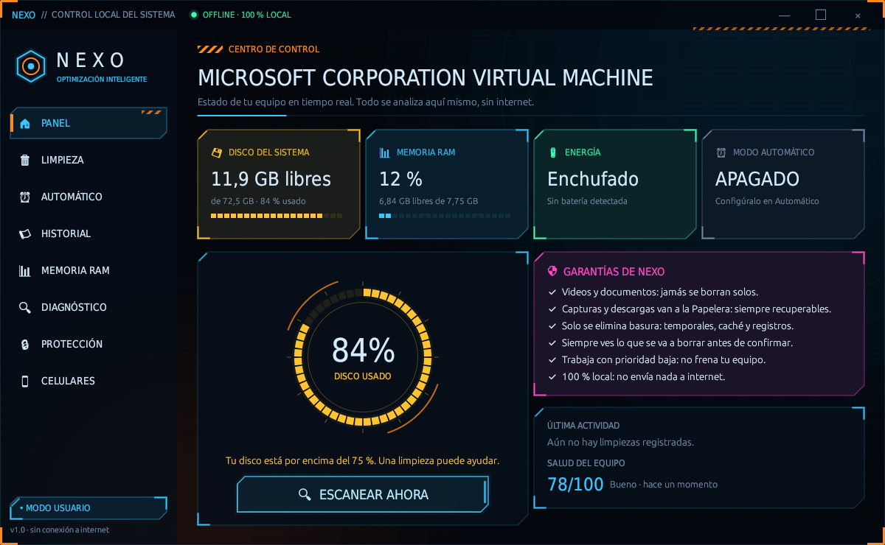
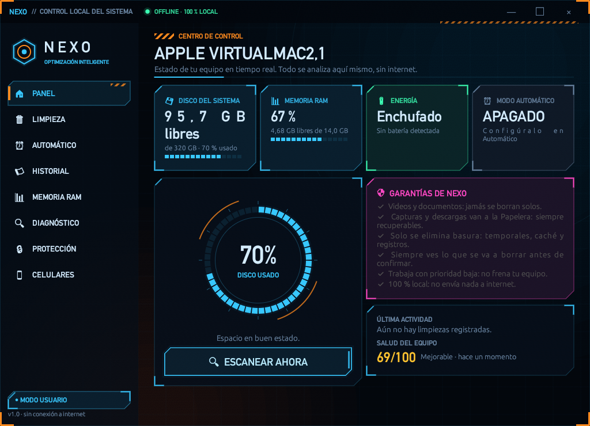
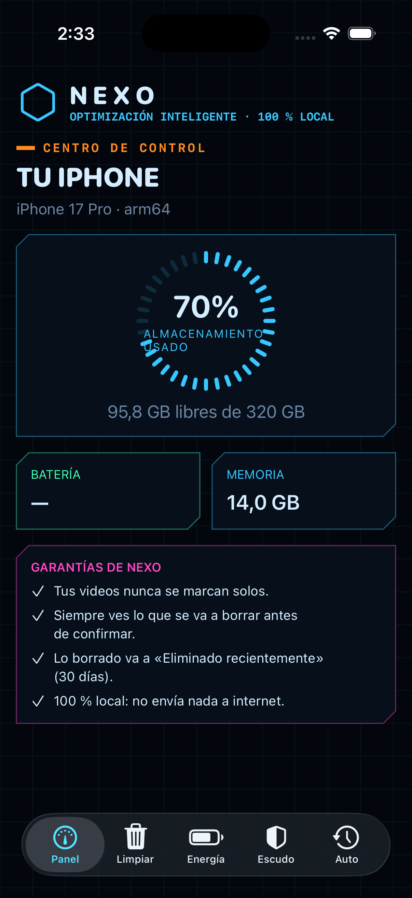
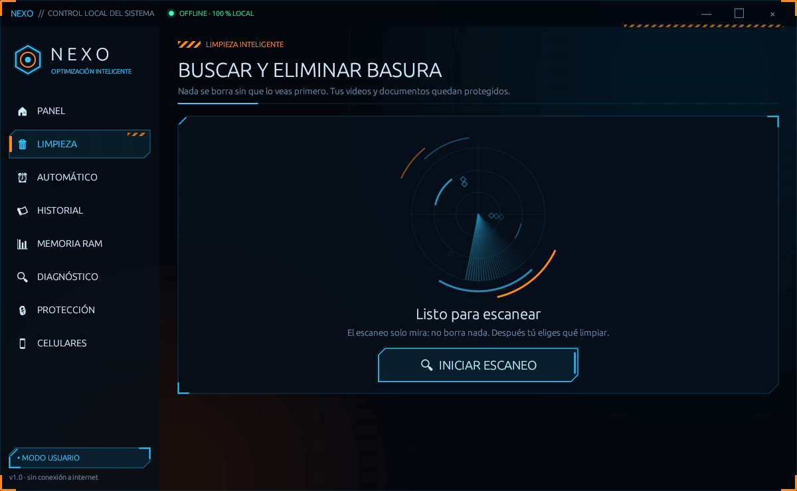
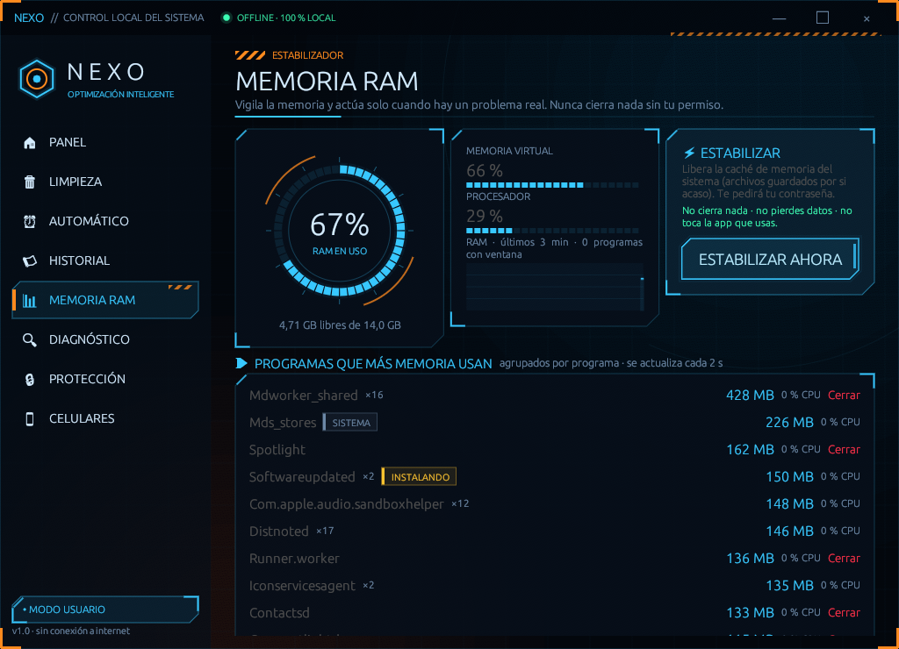
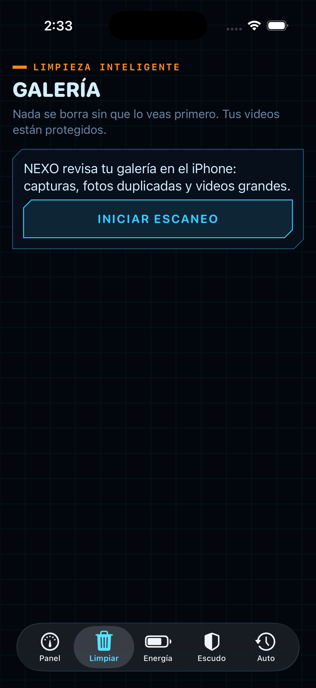

# NEXO

Limpieza segura, memoria, diagnóstico y protección. **100 % local, sin internet.**
Autor: **Chatta Betanzos, Jimy Alexander**.

[](https://github.com/JIMY-BETANZOS-1/nexo/actions/workflows/nexo.yml)

## ⬇️ Descargas

Todos los instaladores están en **[Releases → última versión](https://github.com/JIMY-BETANZOS-1/nexo/releases/latest)**.

| Sistema | Archivo | Cómo instalar |
|---|---|---|
| **Windows 10/11** (64 bits) | `NEXO-Windows.exe` | Doble clic. Si aparece «Windows protegió su PC»: *Más información → Ejecutar de todas formas*. |
| **macOS 11+** (Apple Silicon e Intel) | `NEXO-macOS.dmg` | Abre el .dmg y arrastra NEXO a **Aplicaciones**. La primera vez: clic derecho sobre NEXO → **Abrir** (no está firmado con una cuenta de Apple). |
| **Ubuntu / Debian / Mint / Pop!_OS** | `nexo_*_amd64.deb` (PC) · `nexo_*_arm64.deb` (ARM) | Doble clic → *Instalar*, o `sudo apt install ./nexo_*.deb`. Queda en el menú de aplicaciones. |
| **Cualquier Linux** (Fedora, Arch, openSUSE…) | `NEXO-x86_64.AppImage` · `NEXO-aarch64.AppImage` | `chmod +x NEXO-*.AppImage` y doble clic. No necesita instalarse. |
| **Linux (ejecutable suelto)** | `nexo-linux-*.tar.gz` | Descomprime y ejecuta `./nexo`. |
| **Android 11+** | `NEXO-Android.apk` | Ábrelo en el teléfono y permite «Instalar apps desconocidas». |
| **iPhone (iOS 16+)** | `NEXO-iOS-sin-firmar.ipa` | Ver [iPhone](#iphone) abajo. |

### iPhone
Apple solo permite instalar apps firmadas. Con la `.ipa` sin firmar hay dos caminos:
- **Sideloadly** o **AltStore** (Windows o Mac): conecta el iPhone, arrastra la `.ipa` e inicia
  sesión con tu Apple ID. Con una cuenta gratuita la app dura 7 días y se vuelve a firmar.
- **Xcode** (Mac): `brew install xcodegen && cd nexo-ios && xcodegen generate && open NEXO.xcodeproj`,
  elige tu equipo en *Signing* y pulsa ▶ con el iPhone conectado.

Para publicarla en la App Store o TestFlight hace falta el Apple Developer Program.

## Capturas

| Linux | macOS | iPhone |
|---|---|---|
|  |  |  |
|  |  |  |

## Qué hay en el repositorio

| Carpeta | Qué es | Plataformas |
|---|---|---|
| `nexo/` | Aplicación de escritorio (Rust + egui) | Windows 10/11, Linux x86_64 y ARM64 (X11/Wayland), macOS 11+ |
| `nexo-ios/` | App para iPhone (SwiftUI) | iOS 16+ |
| `nexo-movil/` | App para Android (Kotlin) | Android 11+ |

## Regla de oro (en todas las plataformas)
Nada se borra sin que lo veas. La basura del sistema se elimina; lo tuyo va a la Papelera
(o a «Eliminado recientemente» en iPhone). Los videos y documentos nunca se borran solos.

## Compilar
- **Escritorio:** `cd nexo && cargo build --release` (Rust estable). En Linux y macOS es el mismo
  código: los módulos propios de cada sistema están en `nexo/src/unix/`.
  Paquetes de Linux: `bash empaquetar/linux.sh` (genera .tar.gz, .deb y AppImage).
- **iPhone:** ver arriba (Xcode + XcodeGen).
- **Android:** `cd nexo-movil && ./gradlew assembleRelease` (JDK 17). Para firmar con la llave de
  publicación define `NEXO_KEYSTORE` y `NEXO_KEYSTORE_PASS`; si no, se firma con la de depuración.

## Integración continua y versiones
`.github/workflows/nexo.yml` compila y prueba todo en GitHub Actions (Windows, Linux x86_64 y
ARM64, macOS, simulador de iPhone y Android) y guarda capturas de pantalla de cada sistema.
Para publicar una versión nueva basta con subir una etiqueta:

```bash
git tag v1.2.0 && git push origin v1.2.0
```

El flujo crea la versión en *Releases* con todos los instaladores adjuntos.
